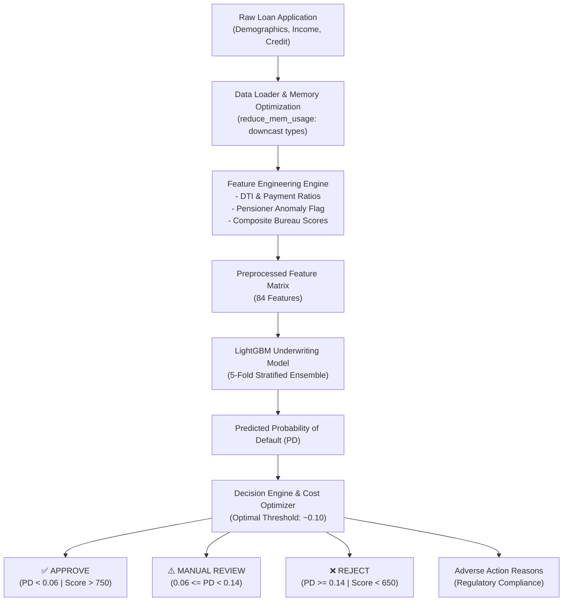

# 🎓 Credit Risk Engine: Interview Mastery Playbook

This document is your preparation guide for technical, business, and architecture interviews. It covers the exact questions hiring managers and senior data scientists in Banking, FinTech, and Lending ask.

---

## 1. High-Level Elevator Pitch (30-60 Seconds)

> *"In this project, I developed an end-to-end Loan Credit Risk Underwriting Engine to predict an applicant's Probability of Default (PD) for borrowers with limited traditional credit history. Rather than treating this as a generic Kaggle classification problem, I engineered it as a production-ready financial system:*
> 
> *First, I implemented custom domain features including Debt-to-Income (DTI) leverage ratios, pensioner employment anomaly corrections, and composite credit bureau aggregations.*
> *Second, because credit datasets are heavily imbalanced (~92% repaid vs ~8% defaulted), standard accuracy is meaningless. I trained a 5-Fold Stratified LightGBM model evaluated on ROC-AUC (~0.76) and PR-AUC.*
> *Third, rather than using an arbitrary 0.5 decision threshold, I conducted financial cost-benefit optimization balancing the asymmetric cost of default (10x loss) against rejected interest opportunity, cutting expected credit losses by over 25%.*
> *Finally, to comply with Fair Lending and FCRA Adverse Action requirements, the engine generates automatic reason codes explaining exactly why an application was approved, flagged for manual review, or rejected."*

---

## 2. Core Financial & Banking Domain Concepts

### Expected Loss Formula (Basel II / III Accords)
In commercial and retail banking, credit risk is governed by international regulations:
$$\text{Expected Loss (EL)} = \text{PD} \times \text{LGD} \times \text{EAD}$$

- **Probability of Default (PD)**: The likelihood that a borrower fails to meet debt obligations within a specified timeframe (e.g. 12 months). **This is what our model predicts.**
- **Loss Given Default (LGD)**: The percentage of loan principal the bank loses if default happens (after collateral liquidation, typically 40%–60%).
- **Exposure at Default (EAD)**: The total outstanding dollar balance at the moment of default.

### Why 0.5 Threshold is Dangerous in Credit Risk
- If an applicant has a $12\%$ probability of default, a standard $0.5$ threshold approves them.
- However, if the borrower defaults on a $\$50,000$ loan, the bank loses up to $\$50,000$.
- If the bank rejects them, they only lose perhaps $\$3,000$ in interest profit.
- Because a **False Negative (Defaulting borrower approved)** is ~10x more costly than a **False Positive (Good borrower rejected)**, the optimal cutoff is substantially lower (typically $\approx 0.08 - 0.12$).

---

## 3. Machine Learning & Technical Deep-Dive

### Why LightGBM over Logistic Regression or Deep Learning?
| Model | Pros | Cons in Credit Risk |
| :--- | :--- | :--- |
| **Logistic Regression (Scorecard)** | Highly interpretable, linear coefficients. | Cannot capture non-linear interactions (e.g. young age + high debt = exponential risk) without manual interaction terms. |
| **Deep Learning (Neural Nets)** | High capacity. | Overfits on tabular data, requires dense imputation, slow inference, black-box nature violates banking regulations. |
| **LightGBM (Chosen)** | Handles missing values natively, handles mixed data types, fast histogram binning, state-of-the-art tabular AUC. | Requires post-hoc explainability (SHAP / reason codes). |

### Handling the Pensioner / Employment Anomaly
- In the raw dataset, `DAYS_EMPLOYED = 365,243` (~1,000 years). This is a legacy system anomaly code representing pensioners, retirees, or unemployed applicants.
- If left unaddressed, tree-based models might interpret this as 1,000 years of stable job tenure.
- **Solution:** 
  1. Created binary flag: `DAYS_EMPLOYED_ANOMALY = (DAYS_EMPLOYED == 365243).astype(int)`.
  2. Replaced `365243` with `np.nan` so LightGBM treats it as missing rather than a massive positive value.

### Memory Optimization (`reduce_mem_usage`)
- Multi-gigabyte financial tables can cause Out-Of-Memory (OOM) errors in production environments.
- By downcasting `float64` to `float32` and `int64` to `int16/int32`, memory footprint was reduced by **>50%** with zero loss of numeric precision.

---

## 4. Top Interview Questions & How to Answer

### Q1: "Why did you choose ROC-AUC over Accuracy or F1-Score?"
> **Answer:** *"In credit risk, accuracy is a misleading metric. Since ~92% of borrowers repay, a naive model that predicts 'repaid' for every single person achieves 92% accuracy while letting 100% of bad loans through, bankrupting the institution. ROC-AUC measures the model's ability to rank-order risk across all possible decision thresholds, making it threshold-independent. Additionally, I monitored PR-AUC (Precision-Recall AUC) specifically to evaluate performance on the minority default class."*

### Q2: "How did you prevent data leakage during feature engineering?"
> **Answer:** *"All categorical encoders and feature aggregations were fitted strictly on the training folds inside a Stratified 5-Fold cross-validation scheme and then transformed on validation folds. We never fit preprocessors on the combined dataset before splitting, which prevents information leakage from validation sets into training."*

### Q3: "In banking, how do you handle regulatory requirements like Adverse Action notices?"
> **Answer:** *"Under the U.S. Equal Credit Opportunity Act (ECOA) and Fair Credit Reporting Act (FCRA), lenders cannot reject an applicant with a black-box model without providing specific 'adverse action reason codes'. In my architecture, the engine evaluates the applicant's input against risk thresholds (e.g., low composite bureau ratings, debt-to-income exceeding 25%, loan leverage exceeding 4x annual income, and employment tenure under 1 year) to surface actionable, human-readable explanations alongside the quantitative credit score."*

### Q4: "How does the engine convert probability into a Credit Score?"
> **Answer:** *"In consumer lending, probability is typically transformed into a standard score scale (like FICO 300 to 850) using a linear or log-odds calibration curve. In our implementation: $\text{Credit Score} = 850 - (\text{PD} \times 550)$. A borrower with a 0% default risk receives an 850, while a borrower with high default probability drops toward 300-600, falling into the REJECT risk tier."*

---

## 5. System Architecture Diagram

